# Playtest guides

Start with [Living Cities acceptance](#task-19-living-city-acceptance) for the new economic v2 mode. [Complete runs](#complete-runs) covers the historical Classic title/run lifecycle; explicitly select Classic when repeating its measured outcomes. [Living archipelago playtest](#living-archipelago-playtest) covers the four-town map. Historical TradingLab and prior-milestone checkpoints below retain their original scenarios.

## Complete runs

Run `python tools/generate_docs.py`, `python tools/prepare_unity.py` and its `--check`. Open `Assets/Scenes/ArchipelagoLab.unity` in Unity 6000.6.6f1 and enter Play mode. The application opens at the Salt & Ledger title screen. These are repeatable verification instructions; the dated [Unity record](UNITY.md) distinguishes checks actually performed.

1. Choose **New Run**. Review the challenge description, objective, deadline, cash and starter assets. Switch among all three charters and verify that descriptions replace each other. Choose **Merchant Company** and **The Coastal Supply Charter**, then **Begin voyage**. Expect day 0, 600 cash, an empty 10-unit Ledger at Northport, and no private factory.
2. Select **Controls**, open **Your trade route**, enable the existing Northport–Eastport Bread policy and start playback. Its defaults are documented in [Runs and charters](RUNS.md). Without extra economic actions it completes on day 29: net 24 Bread, cash 1,014, realized gross margin 414. Confirm the visible Victory screen and frozen day. Inspect score components, procurement, released/held basis, assets and automation usage.
3. Select **Retry**. Expect the same challenge and charter, initial assets and a cleared journal. Use **Menu → Restart this run**, cancel once, then confirm; cancellation preserves state and confirmation recreates the selected start.
4. Use **Menu → Return to Main Menu** and cancel once. Confirming discards the active run. Start another run with **Industrial Consortium**: day 0, 300 cash, an 8-unit Ledger at Westhaven, one granted bakery, two Flour and two Logs. Construction spending and paid inventory basis start at zero.
5. Open **Industrial shipping**. Apply the bakery input-procurement preset, review the warehouse, Bread, shipment 8, reserve 0, Eastport, marginal sale floor 24 and empty return. Apply the shipping policy, then enable it. Return to the map and play. The measured default industrial strategy succeeds on day 39 with 1,027 cash and 814 realized gross margin. Bread must physically leave private storage, travel in cargo and sell at Eastport; no manual transfers are needed.
6. Repeat a fresh challenge without player action, using 10× playback. At day 60 the Defeat screen must appear and stop time. Retry and deliberately **Abandon and inspect results** from the pause menu; confirmation produces a distinct abandonment result with the actual held goods and costs.
7. Try **Regional Relief** and **Enterprise Ambition** from setup. Relief advances only when scheduled regional Bread demand consumes goods; a sale alone is insufficient. Ambition requires both private output and attributed gross margin. Every challenge/charter combination has a measured viable strategy; see the complete-run report.

### Menus, reference and finance

Check at **1366×768** and **1920×1080**, including pointer input, keyboard focus and scrolling:

- Escape closes the trade or industry modal first. With no modal open it opens pause; a second Escape resumes. The Input System navigation-cancel path must behave the same way while a numeric field or dropdown has focus.
- Open Encyclopedia from the title screen, setup, pause and results. Search for Bread, follow its recipe/building links, switch category, scroll a longer mechanics entry and use Back/Escape to return. Help works offline from the staged generated data.
- Open **Ledger** and expand recent events. Compare actual purchases, sales revenue, released historical cost, held basis and construction expenditure. Transfers move no cash; production carries consumed material basis into output. The journal is capped at 200 entries while authoritative totals continue.
- In Settings, test smooth movement and all four text scales. Text size is a locally remembered presentation preference; other settings last only for this application session. No economic run is saved.
- Opening pause, help, finance or logistics stops economic playback. Confirmation must block underlying controls; Escape cancels confirmation without also closing another screen or restarting.
- From results, test Retry, New Run, Main Menu and Encyclopedia without restarting the application. No Continue or saved-run promise is offered.
- In a Windows development player, **Exit Game** must close the actual process. An active run requires confirmation; cancelling keeps it available. Editor Exit stops Play mode. Verify these separately.

### Recorded Task 1.7 Editor views

These are actual Unity Editor Game view captures from the Task 1.7 verification session, not mockups. Main menu, setup, encyclopedia, logistics and results were captured at both **1366×768** and **1920×1080**; the selections below show representative views. [Unity integration](UNITY.md#task-17-complete-run-verification) records the automated tests, live input, economic outcomes and remaining player checks separately.

Pointer-driven setup and playback completed Coastal Supply with Merchant Company on **day 29**, with **1,014 cash**, **414 realized material gross margin** and **1,910 points**. A second run selected Industrial Consortium and applied procurement, shipping and enablement through the visible controls. It produced **30 Bread**, physically delivered **24**, and finished on **day 39** with **1,027 cash**, **814 material gross margin** and **1,810 points**, without repetitive manual transfers.

The recorded navigation also exercised trade-modal Escape priority, pause, confirmation cancellation, resume, retry to day 0, confirmed abandonment, another setup, and encyclopedia search/related-entry Back. Editor Exit stopped Play mode. Standalone build/Exit verification is pending in the linked record; these Editor observations must not be described as player evidence.

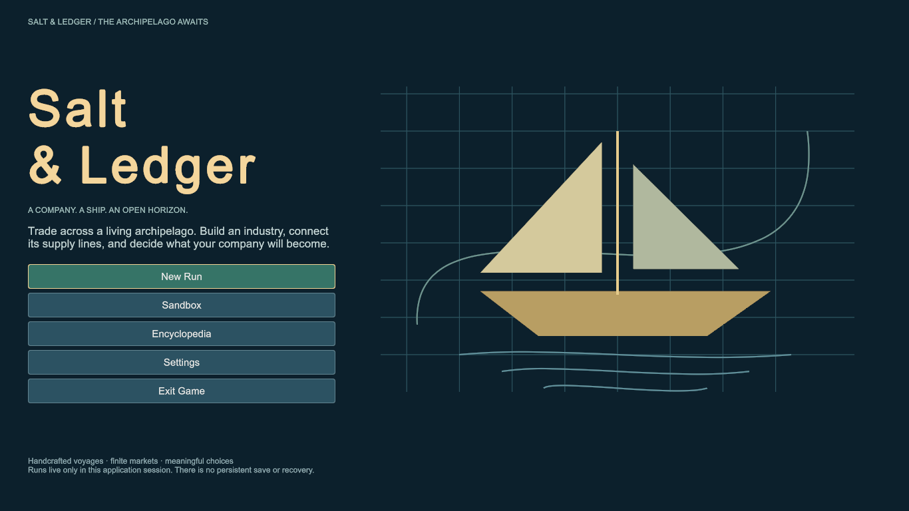

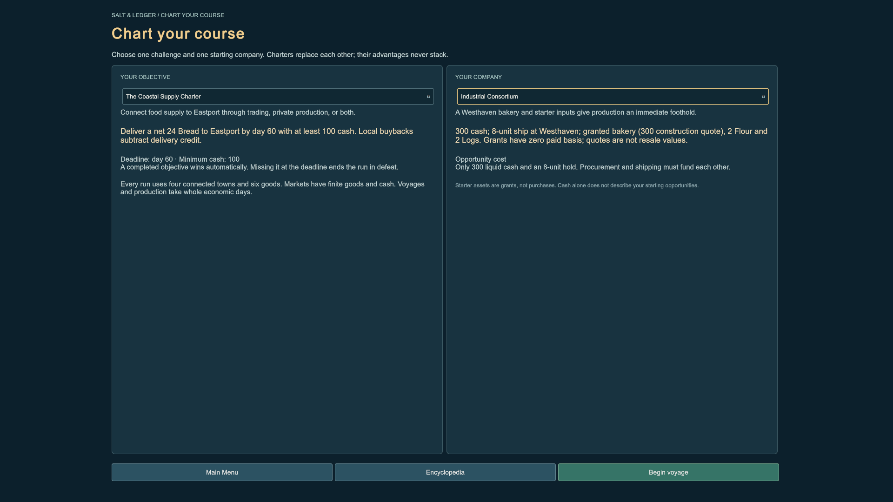

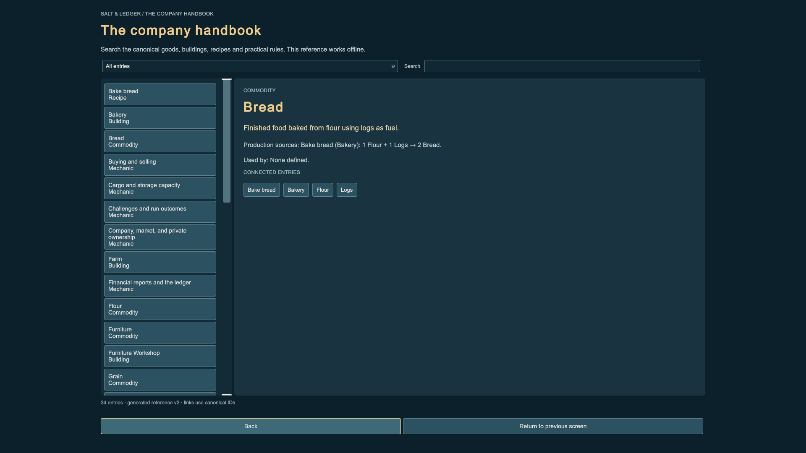

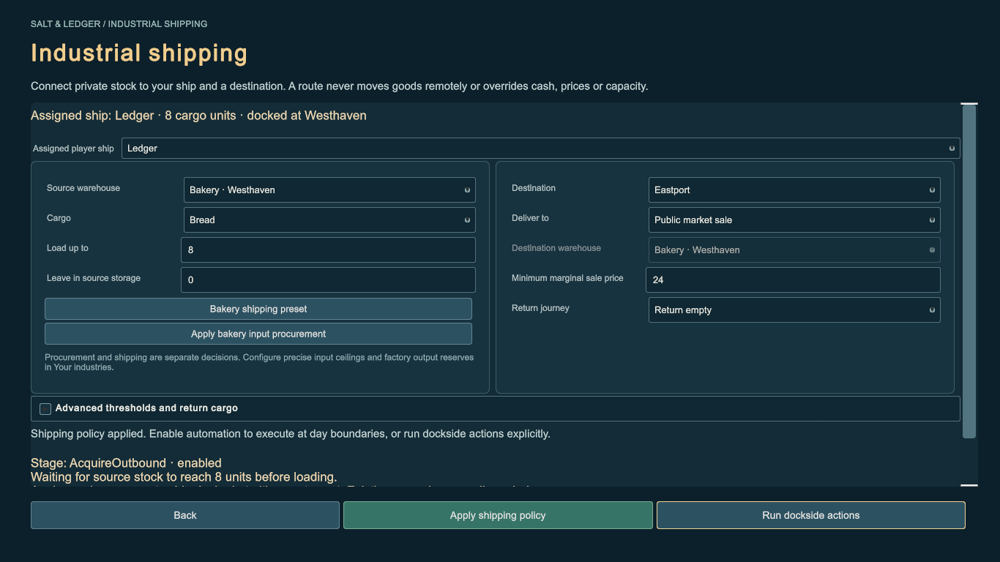

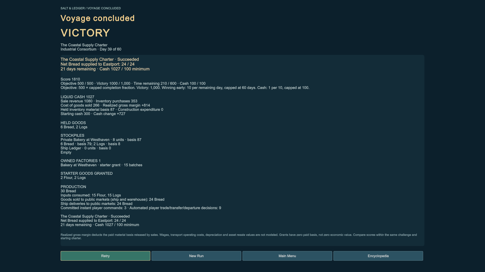

### Industrial blockage and recovery

For a fresh industrial sandbox, configure procurement and a shipping floor of 1,000 before enabling the route. The ship eventually reaches the destination and waits with its Bread intact. Read the explicit reason and compare local bids and liquidity. Pause automation; manual selling or warehouse handling is available only at the actual dock. Replacing the policy requires an empty ship at one of its route ports; enabling/disabling the same policy preserves its stage. Do not expect lower limits to create market cash or missing stock.

Open advanced settings to configure a useful return purchase or private return load. Inspect minimum shipment, source threshold, warehouse reserve, purchase ceiling, expenditure cap and company reserve separately. A warehouse destination must belong to the same company and be at the destination town. Same-good outward/return legs use explicit stages; incompatible extra cargo pauses the policy without disposal.

## Historical TradingLab

TradingLab lets you operate the existing finite two-port economy. It is a small experiment in understanding prices, cargo, travel, and route rules. There is one ship, two goods, and no background clock, replenishment, save system, or win condition.

## Open and run

1. From the repository root, install the Python requirements and run `python tools/prepare_unity.py`, then `python tools/prepare_unity.py --check`.
2. Open `unity/` with Unity **6000.6.6f1**. Let import finish.
3. Open **`Assets/Scenes/TradingLab.unity`** and enter Play mode. The starting world has tick 0, trader cash 100, an empty six-unit ship at Northport, and automation disabled.
4. Give the Game view enough room. Use 1920×1080 or 1366×768 for the intended desktop checks; each of the three columns scrolls independently. Inspect the footer for input/action feedback.

The separate Bootstrap scene remains a production smoke. For Editor tests, the Windows development-player build, and actual verification results, see [Unity integration](UNITY.md). A built TradingLab player starts directly in this scene and stays open for interaction.

## Read the screen

The top strip shows the current tick, trader cash and cash change, total cargo/capacity, individual cargo goods, and accounting status. Cash spent on unsold goods is not automatically a realized loss. A realized gross-profit figure is available after successful trading when the ship is back at Northport with empty cargo; it compares cash against this scenario's empty-cargo starting state. There are no travel costs or other cash flows in this prototype.

**Ports & markets** shows the selected market, cash, stock, next marginal **SELL / BID** and **BUY / ASK** prices, local production, and an expandable pricing-parameter explanation. Click either port to inspect it without moving the ship or spending a tick. The highlighted port is your selection; the connection indicator and ship label show the actual dock or voyage. While sailing, the remaining tick count comes from committed simulation state. Remote prices are current information, not guaranteed arrival-time prices.

**Manual orders & time** shows the selected good's canonical description and both buy/sell previews for the entered quantity. A preview separates the exact total from the first and last marginal prices. Buying six logs initially costs **54**, with unit prices rising from **8 to 10**; buying two costs **16**. Multiplying the first price by six would understate the order. A missing or rejected preview explains the constraint instead of suggesting an executable trade.

**Route automation** shows the applied rule, editable outbound fields, fixed return settings, and the next stage/action/reason. Its proposal is an inspection until you explicitly advance. Recent activity records trades, rejections, production, departure/arrival, and changing policy decisions; it retains at most 40 entries and suppresses repeated unchanged shortages/decisions.

## Controls and time

| Control | Effect |
| --- | --- |
| Port buttons, Good, Quantity | Select or preview; no time passes. Quantity must be a positive whole number. |
| Buy / Sell (1 tick) | Submit one all-or-nothing trade at the selected dock, then run the ordinary production/travel step. |
| Buy + depart (1 tick) | Freshly verify a successful purchase, then buy and start sailing to the other port in the same tick. An unexecutable purchase cannot cause an empty departure. |
| Sail (1 tick) | Depart for the other port; the departure tick is the first of two travel ticks. |
| Next tick (1) | Advance exactly one tick. With automation enabled, use its current decision; otherwise submit no commands. |
| Advance 3 ticks | Execute up to three ordinary ticks; enabled automation can stop early for intervention/no progress. |
| Automation enabled | Enable or pause future policy execution; no tick passes. Disable it before manual orders. |
| Full preset / Restrictive preset | Immediately apply that policy and update the form; no tick passes and the world is not reset. |
| Policy fields / Apply policy | Editing creates a draft. Apply validates and installs it without changing markets, cargo, or tick. Invalid fields preserve the existing policy. |
| Auto tick (1) | Advance exactly one ordinary tick with the enabled policy's commands. An explicitly stepped wait/pause still permits production or existing travel to advance. |
| Run up to 6 ticks | Execute at most six automated steps; stop sooner on a pause or after three consecutive ticks without progress. |
| Scenario selector / Reset scenario | Selection alone does nothing. Reset starts a new selected world at tick 0, applies its preset, clears activity, and disables automation. |

Trading requires the ship to be docked at the selected port; remote inspection does not permit remote execution. Manual orders are unavailable while automation is enabled. Arrival commits at the end of the second travel tick, so the following action may trade at the destination. Every committed trading tick also runs local production. Inspecting, editing, applying, and pausing never advances the economy.

## Complete a manual expedition

Choose **Standard** and **Reset scenario**. Leave automation disabled. Use the combined purchase/departure buttons to reproduce the six-tick comparison:

| Starting tick | Your action | Expected committed state |
| --- | --- | --- |
| 0 | Northport, Logs, quantity 6: **Buy + depart (1 tick)** | Cash 46, six logs aboard, sailing to Southhaven with one tick left |
| 1 | **Next tick (1)** | Docked at Southhaven, still six logs and cash 46 |
| 2 | Select Southhaven: **Sell (1 tick)**, quantity 6 | Receive 144; cash 190, empty cargo; the sawmill uses delivered logs |
| 3 | Select Planks, quantity 2: **Buy + depart (1 tick)** | Pay 35; cash 155, two planks aboard, sailing to Northport |
| 4 | **Next tick (1)** | Docked at Northport with two planks |
| 5 | Select Northport: **Sell (1 tick)**, quantity 2 | Receive 64; tick 6, cash 219, empty cargo, realized gross profit 119 |

Check the changing marginal prices and the activity panel after each action. The full order's total should match its immediate preview. Selecting Southhaven during travel may show hypothetical trade economics, but its actual trade buttons must remain unavailable. The sawmill's output belongs to Southhaven's market, not to your ship.

For the smaller manual comparison, reset and buy only **2 logs** in the first action; sell those two at Southhaven, then use the same two-plank return. It ends at tick 6 with cash **169** and gross profit **69**. See [Manual shipping comparison](SHIPPING_DEMO.md) for the complete accounts and assumptions.

## Compare automation

Choose **Standard**, reset, enable automation, and inspect **NEXT DECISION** before running. It should propose buying six logs and departing, with total cost 54. Click **Run up to 6 ticks**. The ship returns empty to Northport at tick 6 with cash **219** and gross profit **119**. The next loading decision waits because the depleted Northport market exceeds the current buying limit; this is not continuous free profit.

Choose **Restrictive**, reset, enable automation, and run up to six ticks. The initial maximum buy price is **8** instead of **10**, so only two logs meet the rule. The return leg remains two planks. Expect tick 6, empty cargo at Northport, cash **169**, and gross profit **69**. Changing a preset on an already altered world does not recreate these initial comparisons; reset first when comparing them.

Outbound defaults are Logs, target 6, minimum 2, minimum sale price 19, and reserve 0. The target is total cargo to load, including already carried logs. The price limits constrain the worst marginal unit, not an average. The fixed return leg is Planks, target/minimum 2, maximum buy 18, minimum sell 31, with no empty return. These rules do not forecast future destination prices or guarantee market funds.

## Diagnose a liquidity blockage

Choose **No destination cash**, reset, enable automation, and run up to six ticks. The ship buys six logs for 54, arrives at Southhaven, then waits because **the destination market cannot afford a sale**. The bounded run stops at tick **5** after three unchanged waits. Cash remains **46**, all six logs remain aboard, and the cash change of **-54** is tied up in cargo; it is not labeled realized loss.

Select Southhaven and inspect its zero cash and the decision explanation. Lowering the minimum sale price and applying it cannot give the market money: the policy still evaluates actual bids and finite funds. Disable automation without advancing time and inspect legal manual choices. The selected policy cannot solve this liquidity blockage by waiting or changing a price limit. Do not infer that every possible manual strategy is impossible; the lab makes no automatic rescue or global deadlock claim. Reset is a new test world, not an economic recovery action.

## Recover from an overly restrictive policy

1. Reset **Standard**. Set **Maximum buy / unit** to **7**, click **Apply policy**, and enable automation.
2. The next decision should wait because the buy-price ceiling prevents the minimum shipment. Inspect tick 0, cash 100, and empty cargo. No economic action has happened.
3. Change the ceiling to **10** and apply. The world is still unchanged, but the fresh decision now proposes six logs for 54 and departure.
4. Click **Auto tick (1)**. The trade and departure occur together: tick 1, cash 46, six logs, one travel tick left.
5. Disable automation. Verify that pausing leaves that snapshot unchanged. **Next tick (1)** now advances travel manually; at Southhaven you may sell the cargo through the manual controls. Reenabling automation reevaluates the resulting state.

This changes permission to perform a feasible existing trade. It creates no inventory or liquidity and does not claim every blocked economy is recoverable.

## What to observe

- Before buying, can you predict the exact total and explain why six logs cost more per unit than two?
- Can you distinguish the selected market from the ship's actual location, and arrival from a completed destination trade?
- Can you identify whether stock, capacity, your cash, market cash, or a policy limit prevents an action?
- Does the decision explain why automation buys, sails, sells, or waits? Can you apply a draft deliberately and pause without expecting a tick?
- Can you distinguish a limit-change recovery from an illiquid market and from resetting the test world?
- At both intended desktop sizes, can you read values and reach controls using the independent column scrollbars? Record clipping, ambiguous labels, or missing feedback.

Record the scenario, tick, action, expected outcome, and observed confusion. Successful automated checks alone do not demonstrate usability or enjoyment. Legacy TradingLab has no objectives, saving, competitors, consumption, replenishment, cargo valuation, autonomous time, extra routes, or general route editor. ArchipelagoLab below adds its separately specified living-world features. Prices and scenario values remain experimental.

## Recorded Editor views

These actual Game view captures accompany the checks in [Unity integration](UNITY.md#task-14-tradinglab-verification).

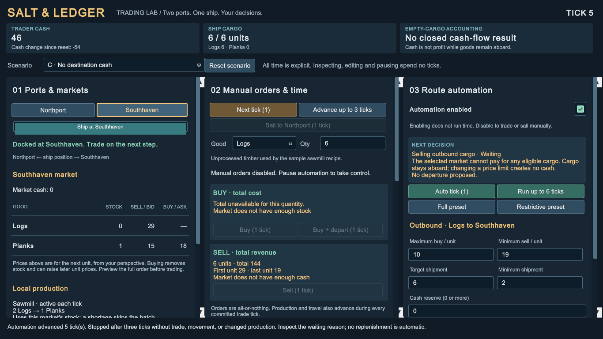

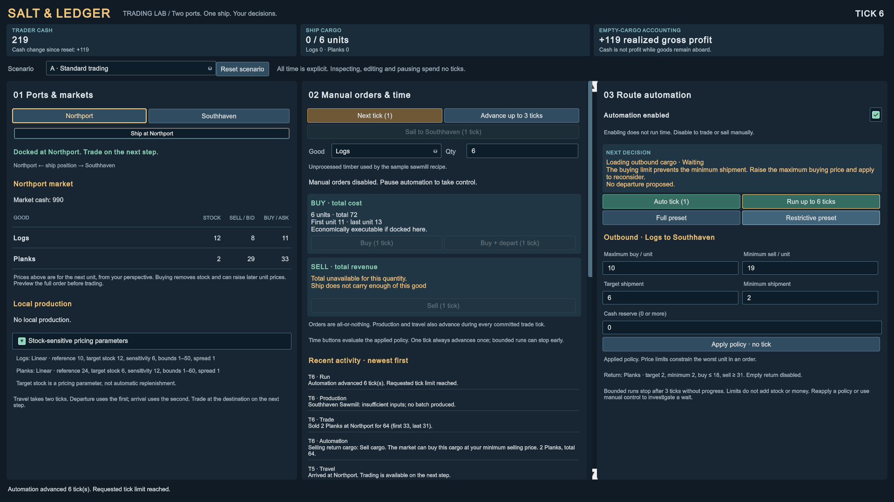

## Commerce and industry playtest

Prepare with `python tools/prepare_unity.py`, open `Assets/Scenes/ArchipelagoLab.unity`, and enter Play mode. Choose Sandbox and Merchant Company from setup. The expanded sandbox starts paused on day 0 with company cash 600, Ledger at Northport with empty capacity 10, six goods, and three independently funded NPC merchants. The older two-port TradingLab instructions above remain separate.

### Trade without moving time

1. Select **your ship**, then right-click Northport. Verify the local trading overlay names Northport and Ledger. Opening pauses playback without sailing or trading.
2. Inspect all six commodity rows: canonical names, town stock, ship stock, marginal sell/buy prices. Select Logs, then adjust quantity using numeric input and the 1/5/maximum controls. Read exact total, average, first/last marginal prices, resulting cash/cargo, and any rejection.
3. Buy a small executable quantity. Stock, cash, cargo and prices must update immediately while the day remains unchanged. Buy again, then use **Sell now** to sell part of the cargo without closing the overlay. Check that the new preview uses the new inventory edges.
4. Enter an unaffordable or over-capacity quantity. The full order must be unavailable/rejected; no hidden partial fill, cash movement or day advance. Maximum must choose an executable quantity or explain that none exists.
5. Close with Escape. Reopen using **Trade / inspect market**. Close with the clear close button and again by clicking the backdrop. Opening/closing must not activate the map beneath; keyboard focus must return sensibly and playback remain paused.
6. Select Ledger and right-click Eastport. Verify remote information and the docking explanation. Buy/sell execution must be disabled. **Sail Here** is a separate explicit action, available only for a legal departure; opening the remote overlay itself must not sail.
7. Depart, reopen a market while sailing and verify it remains read-only. Advance the actual voyage days; trading becomes legal immediately after the arrival commit. Inspect an NPC and verify that its cargo/account are visible without granting trading control.

Average execution price describes this proposed transaction. The interface does not invent a historical acquisition price for cargo. A remote quote is current information, not a guaranteed arrival quote.

### Invest, produce, and transport

1. Reset to a new sandbox. Select Westhaven and open **Your industries**. Review eligible canonical facilities, construction cost, batch inputs/outputs, interval and capacity.
2. Construct a bakery. Company cash decreases by 300 and Westhaven market cash increases by 300 on the same day. Private storage starts empty; no free batch appears. Inspect the next due day.
3. Configure procurement of flour and logs, preserving 100 cash; retain output for shipping or enable local sales deliberately. Apply the settings once. Advance days and inspect actual purchases, recurring private batches, input consumption, output stock, deadlines and waits.
4. Confirm bread belongs to private storage rather than the public market. Local sales should move that stock into the town market and pay company cash using the exact preview. Purchased-stock expenditure, capital cost, revenue and unsold goods must remain distinct.
5. Sail Ledger to Westhaven. With ship automation disabled, load a small quantity from the bakery. Verify side-by-side stock and capacities, unchanged cash/day, and equal physical quantity moved. Transfer some back and repeat the comparison.
6. Try to load while the ship is elsewhere or sailing, and try to exceed available stock or capacity. Transfers must be blocked/rejected without goods or cash changes. Remote factory management may buy/sell locally, but cannot load the distant ship.
7. Raise an input limit enough to permit purchase, then lower it to create a visible price wait. Test a cash reserve and a high output sell floor. Applying policy changes must not produce or trade immediately; policies act during day advances. A limit edit creates no liquidity or stock.

Factory output can also block on capacity or lack of local buyers. Disabling/re-enabling preserves its production deadline. Task 1.7's Industrial shipping panel can collect private output automatically; the steps above deliberately exercise manual transfers as a physical-ownership check.

### Try the charter and recover the session

Choose **New Run → The Coastal Supply Charter** for a fresh goal of 24 net Bread supplied to Eastport by day 60, retaining 100 cash. Progress increases only after actual player-company sales into that market; buying Bread back subtracts credit. Cargo aboard a nearby ship, NPC sales and warehouse transfers do not count.

Two current approaches are described in [Runs and charters](RUNS.md): a configured Northport–Eastport Bread route, or a Westhaven bakery with procurement and automated private shipping. [Commerce and industry](ENTERPRISE.md) retains the older manual industrial experiment. The scripts demonstrate feasibility, not a requirement to copy their exact actions.

Wait without supplying anything to observe failure at day 60. At a terminal result, economic controls stop and results remain visible. Retry restores the selected charter's initial assets, including any granted facility, with no accumulated progress. Sandbox restores unlimited play. Test pause, explicit next day, 1×/3×/10× speeds and modal opening during playback; no clock should run through an open trade modal.

At 1366×768 and 1920×1080, verify the full trade controls are accessible without scrolling the entire modal. Inspect text clipping, goods-row targeting, button contrast, focus, backdrop interception, error visibility, policy scrolling and physical-transfer controls. The [Unity verification record](UNITY.md) distinguishes actual interaction, automated tests and player startup.

### Recorded commerce and industry checks

The following checks were performed through actual Unity Editor controls using the official Unity Agent Plugin. They are separate from the historical Task 1.5 records below. See [Unity integration](UNITY.md) for the complete test/build record, including the 45 Edit Mode and 19 Play Mode cases and player verification limits.

| Observed flow | Authoritative checkpoint |
| --- | --- |
| Northport, day 0: buy 2 Logs for 20, buy 2 more for 22, sell 1 for 9 | Cash 567, cargo 3 Logs, day 0, revision 3. Each order refreshed stock, prices and previews immediately. |
| Select maximum purchase after those orders | Quantity 7, exact total 89, displayed average 12.71 per unit. This is the executable purchase preview, not a historical cost basis. |
| Open/close and permissions | Right-click opened local, remote and NPC inspection views. All six goods were selectable. Escape closed both trading and industry overlays; close buttons, the backdrop and visible Trade alternative worked. Opening/closing issued no voyage or trade. Markets remained read-only while sailing. |
| Northport bakery, fresh sandbox | Buy 2 Logs for 20, construct Bakery for 300: company cash 280. Buy 1 Flour into private storage for 24 and transfer 1 owned Log from the ship: cash 256, private stock 1 Flour and 1 Log, still day 0. |
| Advance that bakery to day 2 | Private production yielded 2 Bread while the town still held 8 public Bread. Load 1 private Bread onto the ship without a cash change; sell the other locally for 17: cash 273, day 2, revision 8. |
| Apply operating policy | A later daily phase bought 3 Logs for an actual total of 41. The Flour price exceeded the configured buying limit, so the facility visibly waited for inputs on day 4. Applying a policy did not bypass the price limit or guarantee production. |
| Remote industry management at 1920×1080 | With Ledger still at Northport and cash 567 after the trade check, construct a Westhaven Bakery for 300: cash 267. Both ship-transfer directions remained disabled. Apply the recommended operating policy once and advance two days: one batch, actual purchases 70, actual sales 85, cash 282, and private stock 2 Flour plus 2 Logs. No repetitive toggling was needed. |
| Default merchant route in a fresh charter | Day 5: 8 net Bread supplied, cash 776. At 10× playback, success committed on day 29 with 24 net Bread and cash 1014; playback stopped. Reset restored day 0 and cash 600 with charter mode retained; New sandbox cleared the objective. |

The Northport bakery sequence above deliberately uses manual local procurement to make ownership visible. The Westhaven walkthrough and the shared operating preset demonstrate the alternative of configuring recurring local purchases. The factory's actual spending, revenue and retained goods remain separate; these checkpoints do not assert a fully attributed industrial profit.

Both trade captures below were taken at the actual indicated Game view resolutions and visually inspected. All six rows, quantity and maximum controls, buy/sell actions, close control and status message fit without scrolling the entire modal. The industry views at both sizes were also exercised with independent policy scrolling.

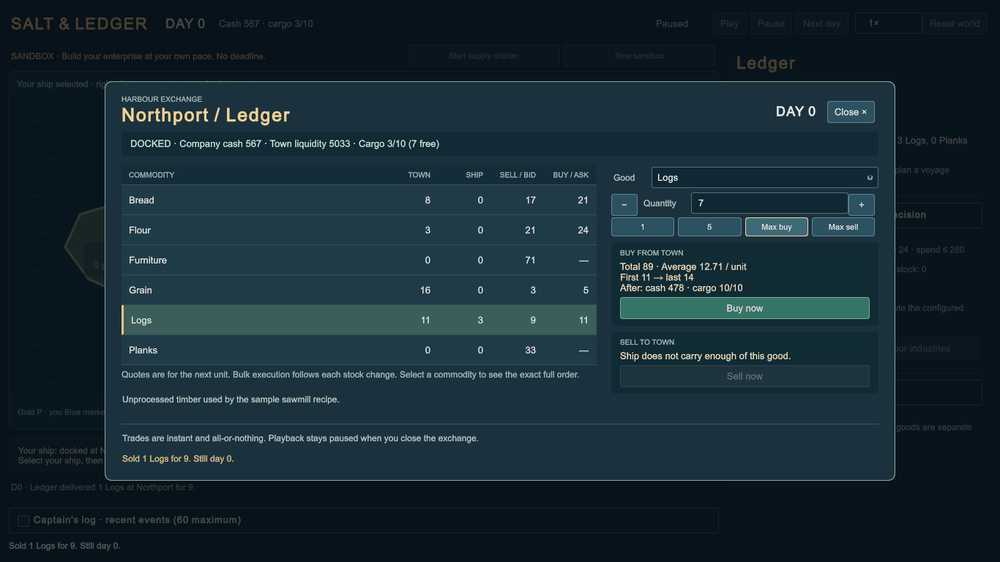

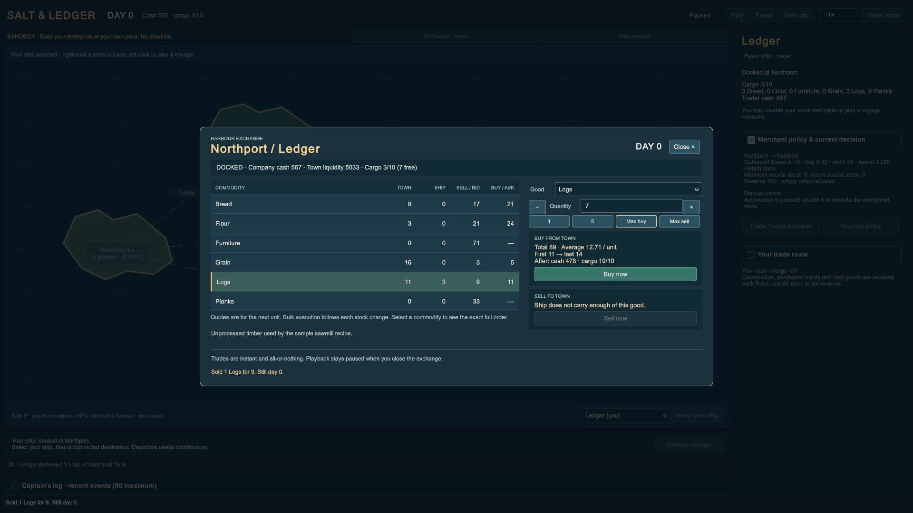

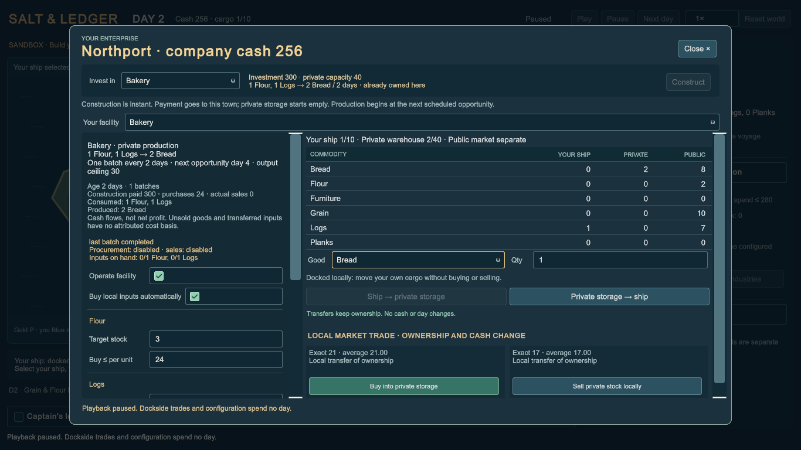

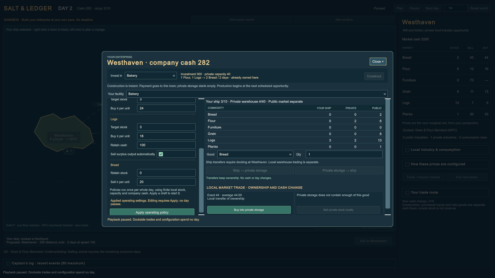

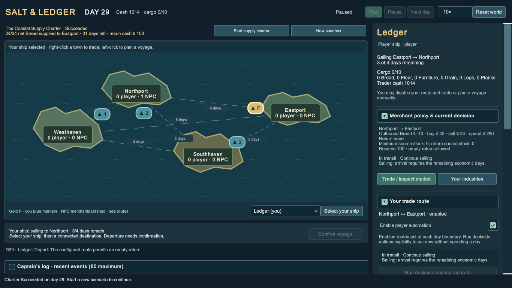

## Living archipelago playtest

The following Task 1.5 procedures and screenshots are historical regression evidence for the two-good `ArchipelagoScenario` fixture. Current ArchipelagoLab uses the expanded scenario and the commerce/industry procedures above; its initial amounts, policies, UI and ship count differ. The old fixture remains available to headless/session tests.

Run `python tools/prepare_unity.py` and its `--check`, open `unity/` in Unity **6000.6.6f1**, and open **`Assets/Scenes/ArchipelagoLab.unity`**. Enter Play mode. The world starts **paused, day 0**, with Ledger at Northport, cash 200, capacity 8, empty cargo, and player automation disabled. Two NPC merchants are already enabled but do not act until a day is advanced. Bootstrap and TradingLab remain separate scenes.

Use a 1366×768 or 1920×1080 Game view. The map is the main space; the selected-object panel scrolls independently. The gold **P** marker is Ledger; blue merchant markers are inspectable NPCs. The **Inspect ship…** fleet selector lists every ship and its player/NPC ownership, including ships whose sailing markers overlap. Port labels include authoritative dock counts. Select ports for stock, next marginal buy/sell prices, market cash, industries, and demand. Select ships for their real cargo, owner cash, voyage, and current decision. None of those selections spends a day.

### Controls and time

| Control | Effect |
| --- | --- |
| Play / Pause | Start/stop main-thread whole-day playback; pausing clears pending elapsed time |
| Next day | Pause and commit exactly one complete economic day |
| 1× / 3× / 10× | Change presentation cadence; base interval 1.5 seconds/day, bounded to four days per frame |
| Reset world | Construct the same fresh day-0 scenario, clear activity, disable player automation, restore paused 1× |
| Port / ship marker | Inspect that authoritative object; no day or revision change |
| Inspect ship… | Select any ship from the fleet, including coincident sailing markers; no command or time change |
| Select your ship, then port | Propose a direct voyage and show distance/duration; no departure until confirmed |
| Confirm voyage | Pause playback and start the player's voyage immediately; no day passes |
| Dockside trading foldout | Opening pauses playback for a stable manual interaction |
| Good / Qty | Refresh hypothetical exact previews; valid quantities are positive whole numbers |
| Buy now / Sell now | Immediate all-or-nothing transfer at the actual dock; revision changes, day does not |
| Route fields / Apply route | Draft then validate both directions; application changes policy/revision but not stocks, cash, or day |
| Enable player automation | Set future actor scheduling; no immediate trade or day advance |
| Run dockside actions | Pause playback; run at most four player policy actions now without daily production, consumption, or travel |
| Captain's log | Inspect at most 60 recent structured events; no time or hidden simulation history |

Manual orders require player automation disabled and the actual dock. A remote preview is economic information, not permission to trade. A paused world remains paused after a manual trade/order. Resume explicitly when ready. Changing speed does not change the results for the same ordered commands and number of economic days.

### Verify instant transactions and a geographic voyage

1. Reset. Select Northport and open **Dockside trading**. Select Logs, quantity 2. The initial exact buy total is 20; inspect first/last marginal prices separately.
2. Buy. Day remains 0; cash becomes 180 and cargo holds two logs. Northport stock and the next quote update immediately.
3. Buy two more after reading the new preview, which costs 22. Day is still 0; cash is 158, cargo four logs, and the state revision has advanced twice.
4. Try a quantity exceeding remaining cargo room. Execution must be unavailable or reject the whole request without spending a day or changing goods/cash. Invalid text must not submit a command.
5. Click **Select your ship**, then Southhaven. Inspect distance 300 and duration 3 days. Nothing sails until **Confirm voyage**.
6. Confirm. Day remains 0, the ship is underway with three days remaining, and trades are unavailable.
7. Click **Next day** three times. Remaining travel is two, one, then docked. NPCs, production, and demand advance in those same days. Select NPC markers and towns to inspect their movement and changing dock counts.
8. On committed day 3, select Southhaven and sell the four logs using the fresh exact preview. The sale succeeds immediately on day 3 if the displayed market can pay; no extra arrival/trading day is required.

Do not expect the old TradingLab 119/69 outcomes here: the geography, independent merchants, daily schedules, and instant trading are intentionally different.

### Watch a living world without player intervention

Reset, leave player automation disabled, and use playback. At day 1, both NPCs have purchased real cargo and departed on their three-day routes. Their source stocks, accounts, and local quotes reflect those purchases. At day 3 they arrive; at the following daily actor phase they can sell and return. The ledger stays idle unless ordered.

Expand Northport's industry detail to inspect +2 logs every 3 days and ceiling 18. Southhaven shows the canonical 2-log → 1-plank recipe every 2 days, input availability, next opportunity, enablement, and waiting outcome. Eastport consumes a plank every 4 days; shortages record unmet demand without creating goods. Westhaven's unused logs eventually stop at its configured ceiling.

Pause during a voyage. The marker should settle at the committed position, and no additional economic day should appear while paused. Resume at 3× then 10× and verify legible moving markers, selectable objects, and occupancy changes. The fastest mode may skip intermediate visible days, but authoritative arrival and market access still follow exact daily commits.

### Configure both directions and recover from a restrictive rule

Reset, open **Your trade route**, and inspect origin/destination, both commodity selectors, both target/minimum quantities, both marginal buy/sell limits, both purchase caps, reserve, and empty-return permission. Numeric fields are drafts until **Apply route**. Return None requires empty return; equal outbound/return goods are explicitly rejected. Invalid drafts must preserve the prior policy.

Set outbound buy maximum to **1**, apply, and enable automation. The decision should explain why no minimum log shipment meets that price. **Run dockside actions** makes no trade and spends no day. Raise the ceiling to **14**, apply, and run again: the initial six-log purchase/departure is feasible, with exact total 66, leaving cash 134, six logs, day 0, and three travel days remaining. The expenditure cap and reserve must still be enforced.

Advance to arrival. Run dockside actions to unload and, if current return stock/prices permit, buy return planks and depart during the same day. Inspect every exact transaction and retained cargo. Change a sell floor upward to create a wait, then lower it to a feasible value; this changes permission, not cash or inventory. A price edit cannot solve actual market insolvency.

Disable automation without moving the clock. Legal manual controls should become available according to the ship's real location; an existing voyage continues only when days advance. Reenable or replace the route to evaluate the committed cargo/location rather than resetting a hidden phase. Changing ports while carrying incompatible cargo may require deliberate manual intervention.

### Check ownership, competition, and presentation

- Select each NPC while docked and sailing. Use **Inspect ship…** when voyage markers coincide. Cargo, owner cash, destination, remaining days, and policy reason should be inspectable; player manual controls must never command that NPC.
- Compare an idle reset with an enabled player route. All actors use the same stocks and prices; player purchases can reduce what a later merchant can load.
- Expand local industry/demand and pricing details. Values should match the selected town's actual schedule/configuration, including ceilings, input shortages, unmet demand, and recent real deliveries.
- Read exact bulk previews before acting. A first marginal quote times quantity may be wrong; sale revenue and market liquidity are distinct constraints.
- At both desktop sizes, ensure town/ship markers and primary clock/voyage controls remain reachable while detail panels scroll. Check overlap offsets, selected highlighting, readable waiting reasons, and collapsible activity.
- When cargo is unsold, cash change must not be labeled realized profit/loss. Reset is a fresh test world, not a recovery action or subsidy.

Record the day, revision, selected object, action, expected result, actual result, and confusion. The [headless comparison](LIVING_ARCHIPELAGO.md#reproducible-sixty-day-experiments) provides reproducible economic evidence; it is not a substitute for observed human understanding. Actual graphical/test/player verification and screenshot evidence are listed in [Unity integration](UNITY.md).

### Recorded archipelago views

These actual Editor Game view captures use the verified runtime resolutions and final map/fleet controls. Both show day 7 with the player idle while NPC merchants have purchased, transported, and sold real goods. [Unity integration](UNITY.md#task-15-living-archipelago-verification) records the separate manual, policy, playback, motion, and test evidence.

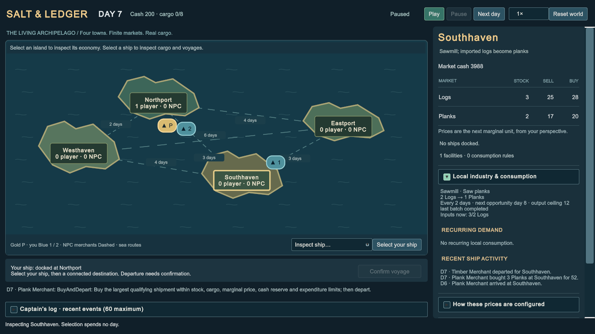

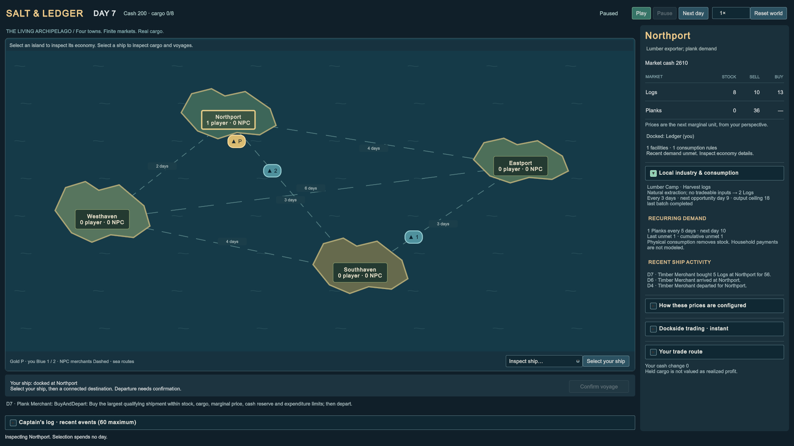

Task 1.7's final verification also passed **29 Play Mode tests** and the Windows development player's real Exit flow: settings and reference navigation, run setup, Escape pause, Exit cancellation, and confirmed application shutdown were exercised through the official runtime input tools. Full visible merchant and industrial victories were verified in the Editor. See the [complete verification record](UNITY.md#task-17-complete-run-verification) for exact evidence and remaining platform/graphics limitations.

## Seeded worlds, Ascension and readability

Use Settings to select Compact, Default, Large and Extra Large. At 1366×768 and 1920×1080 inspect the title, setup, port market, trade, industry/warehouse, encyclopedia, route editor, ledger, pause, confirmation and results. Primary actions and Close must remain reachable; long sections scroll internally. Text-size changes and newly created controls must retain the chosen scale without changing day/revision. Restarting the player should retain only that presentation preference, not a run save.

1. New Run → Seeded Archipelago → enter `-42`; choose Industrial Consortium and Ascension 1. Preview all four positions and six routes. Copy seed and confirm it is `-42`. Invalid text such as `2147483648`, `1.5` or whitespace must disable Begin voyage.
2. Begin voyage. Inspect Run identity in the sidebar, the matching town locations and route distances/days. The inherited Westhaven bakery is already operational and eligible on day 2. Changing Settings, opening help or pausing must neither reroll nor advance the world.
3. Retry Same World through its confirmation. Funds, goods, factory policies, day/revision, journals and ship location return to their initial state with the same identity. New World / Reroll instead opens setup with a different seed; nothing starts until Begin voyage. Change Setup retains existing selections.
4. For the construction timeline, choose a Merchant Company sandbox, seed `-42`, Ascension 1. At Northport construct a bakery on day 0: company cash falls from 600 to 300 and the town receives 300. The site is owned, under construction, with two days remaining and first eligibility day 4.
5. Prepare the recommended procurement draft; inspect its Flour/Logs limits and cash reserve, then Apply. No purchase occurs on Apply. Manual pre-storage is allowed: buy one Flour and one Log into this warehouse through their exact local previews if desired; this does not make the site operational.
6. Advance to day 1: one construction day remains; no automatic purchases, sales or batches. Day 2 completes the site with zero further capital payment and still no batch. Day 3 may procure under the applied policy but cannot produce a 2-day bakery batch yet. Day 4 is the first opportunity, conditional on inputs, operation and storage. Repeat under Ascension 0: the site is immediately operational and first eligible on day 2.
7. Inspect the status summary, missing-input exact quote, separate ship/private/market quantities, committed purchases/revenue/capital and held material basis. Recommended settings remain a draft until Apply. A ceiling of 1 should expose a real price wait; restoring a feasible ceiling permits ordinary purchases, not free stock.
8. Return to the Industrial Consortium Coastal run, seed `-42`, either ascension. Apply the displayed bakery input procurement preset and the bakery-to-Eastport physical shipping policy, enable the ship, and advance days. The benchmark reaches victory on day 28. Results must show seed, generator version, ascension, challenge/charter, real accounts and qualified score group. Retry retains that identity. Abandoning a different run with a pending site must preserve its pending state/dates in results and freeze further completion.
9. Exercise Tab/numeric editing/dropdowns, Escape from a focused trade field (close only the trade), Escape again (pause), confirmation cancellation, Resume, and confirmed Exit. Verify clicks on a modal cannot select a town behind it. Repeat the relevant input flow in a Windows development player; Editor stop-Play is distinct from player Application.Quit.

Record actual observations and screenshots separately from automated tests. [Seeded analysis](SEEDED_RUNS.md) provides geography and economic benchmarks; [Unity verification](UNITY.md#task-18-seeded-run-and-readability-verification) records which runtime/platform checks were actually performed.
## Task 1.9 living-city acceptance

Use **Living Cities / economic v2**, seed **42**, Merchant Company, stock-only pricing and Ascension 1. Historical Classic and seeded-v1 remain separate setup choices. Begin from the main menu; changing setup fields must not advance the current world. Preview the four actual roles, population, cash, eligible private industries and six voyage estimates before starting.

1. Select Westhaven and compare Overview/Market tabs. At Default, the primary city summary, market table and fixed trade/industry/city buttons should fit at both 1366×768 and 1920×1080. Repeat Compact, Large and Extra Large; larger scales may use intentional internal scrolling. Open ordinary docked trade and verify quantity, exact total and Buy/Sell are reachable; Close remains fixed.
2. Open City economy → People & money. Market and household cash have distinct cards. Before the first food observation, purchasing power must say it is awaiting observation. Inspect Needs & coverage and Industry & trade; selected-tab styling must remain distinct when keyboard focus moves. City help opens the offline accounts article; follow its needs link, then Escape through history and back to the paused city screen.
3. Inspect Eastport, the forest-furniture town for seed42. It has a Lumber Camp and Furniture Workshop, requires imported Planks and cannot construct a Sawmill. Compare the private blueprint picker with the same canonical eligibility shown in setup. Trade permissions remain independent of production capabilities.
4. Enable the default merchant route using Controls, then advance days. The challenge target is Northport. By day5 the route has sold eight Bread there; two remain aboard. Day6's logging wage leaves market cash2 and household cash464. Through day7 the remaining sale is blocked by market funds. Day8's actual paid Bread purchase costs39, leaving market41/households425; disabling automation permits an immediate exact one-Bread sale for37. This spends no day. Do not interpret household wealth as direct permission for a market purchase.
5. Retry the same identity and leave the merchant route enabled. It succeeds on day28 with cash664, six food observations and the baseline-protected welfare conditions. Inspect the real result/score, then verify terminal freeze. Retry restores day0, original funds, city history and journal. An idle retry fails on day90 with genuine deprivation; neither path invents rescue money.
6. For private employment, use the Industrial charter's operational processing-town bakery or purchase an eligible new bakery. Material basis and paid wages are separate. Ascension1 new purchases remain pending until end of D+2 and cannot procure/produce/sell early. Configure inputs explicitly and inspect actual payroll/input/capacity waits. Existing warehouse transfers require the correct dock and owner.
7. Exercise right-click trade, numeric entry/Tab, modal map-input blocking, Escape priority, pause, Ledger, encyclopedia, results, retry/reroll and Exit. Exit must close the standalone application through its own confirmation flow. No run persistence is promised.

These steps describe reproducible checks, not a claim that every step was manually repeated in every backend. The actual Editor/player results, screenshot coverage and remaining limits are recorded in [Unity verification](UNITY.md) and [readability evidence](READABILITY_VERIFICATION.md). The [living-city experiment](LIVING_CITIES.md) documents longer-run decline under the tested policies; a day28 challenge victory does not establish perpetual solvency.
