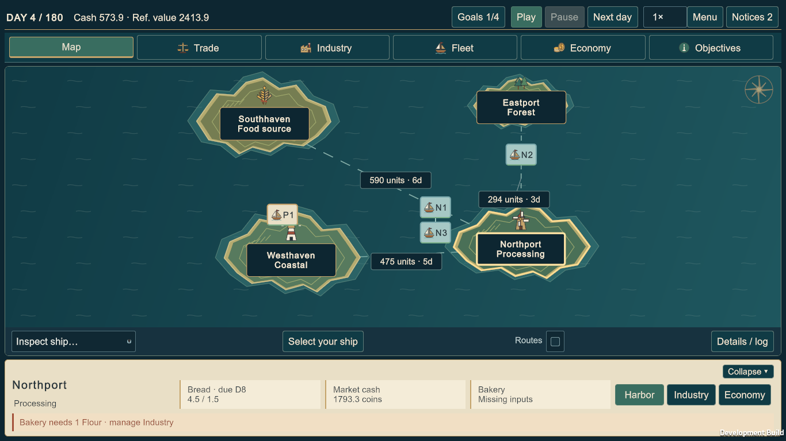
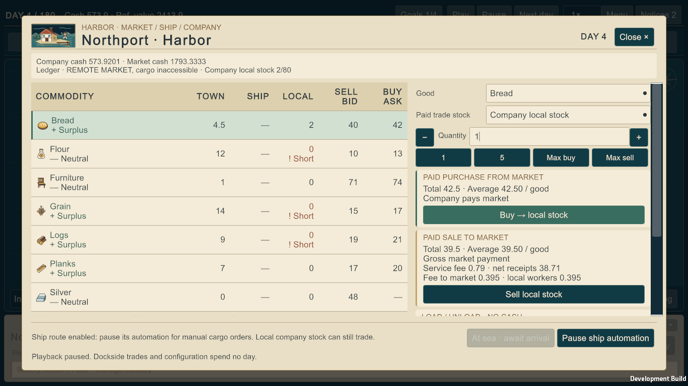

# Task 2.5 verification — Map-First Command Deck

**Status: implemented and verified through the available Editor/player paths.** All 21 criteria are audited below. Native Windows device injection could not be exercised because the computer-use service was unavailable; actual UI Toolkit navigation, key and pointer events, rendered Windows players and exact continuation were exercised. This limitation is not reported as a native-input pass.

The authoritative scope is `tasks/TASK-2.5.md`, including the revised illustrated direction and all 21 Definition-of-Done criteria. Actual checkout HEAD was verified as `3feb6b5c1fa88fbc3c176ffdc89f5de9a02aaf92`. The implementation preserves economic rules and schemas 1–5; no Pages publication or configuration change is part of this work.

## Implemented boundaries

- `ArchipelagoCommandDeck.cs` and `ArchipelagoWorkspaces.cs` compose the compact HUD, Map/Trade/Industry/Fleet/Economy/Objectives navigation, contextual deck, Fleet workspace and town Economy. The existing Harbor, Industry, planner, Journal, City Economy, Ledger, save and results operations remain the action destinations.
- `PresentationContext` contains presentation state only. Session selection remains authoritative for the inspected town/ship and owned command ship. Management navigation pauses playback; closing a view does not resume it.
- `EconomicSignals` reads a committed snapshot and canonical definitions. It reuses exact demand/retail and public/private batch rules; it neither advances a world nor reserves stock. Current readiness, due date and last committed outcome are separate. Public readiness was mechanically extracted into a shared helper used by `RegionalCirculation`; there is no economic retuning.
- `MapViewport` supplies one fit/inverse transform for the live map and setup preview. Geometry, navigation buttons, route overlays, interpolation and art anchors share it. There are no pan/zoom/minimap controls or camera fields in saved state.
- `IllustratedMaritime.uss`, `MaritimeGlyph`, `MaritimeIllustration` and `ArchipelagoMaritimeKit` supply the shared nautical/paper visual family. Existing text scale remains unchanged. See the [design system](UI_DESIGN_SYSTEM.md) and [asset provenance](design/task-2.5/PRODUCTION-ASSETS.md).

## Executed checks and evidence boundaries

Counts below are actual completed results. Focused suites overlap with broader suites and must not be added together as a count of distinct tests.

| Check | Actual result | Evidence / limit |
| --- | --- | --- |
| Locked .NET restore | Passed after normal-access retry | Initial sandbox attempt failed with `NU1301` because the NuGet socket was blocked; that failure was not accepted as a pass |
| Release solution build | Passed, 0 warnings and 0 errors | `.cache/task25-headless/release-build.log`; simulation remains C# 8 / `netstandard2.1` |
| Full .NET suite | **1066/1066 passed**, 0 failed, 0 skipped | `.cache/task25-headless/task25-headless.trx` and `full-dotnet-tests.log`; 229.32s command duration |
| Ordinary headless demos | **5/5 passed** | Demo, world, market, shipping and automation |
| Reproducible report checks | **11/11 passed** | Completed headless manifest; all 11 initial-checkout report JSON hashes unchanged |
| Focused `EconomicSignalsTests` | **26/26 passed** | Exact residuals, current food stock versus affordability, four historical modes, public/private readiness, pooled contention, pending sites, numeric boundaries and exact save non-mutation |
| Circulation/living/pooled focused regressions | **52/52 passed** | Progress record; executed after the shared public-readiness extraction |
| Full Unity Edit Mode | **115/115 passed**, 143.74s | Final imported source; includes 17 map/projection/route/callout cases; zero skipped/inconclusive |
| Full Unity Play Mode | **85/85 passed**, 125.79s | Includes 11 command-deck cases, exact v3 fee layout, real operations, terminal inspection, all-scale legacy controls and saves; zero skipped/inconclusive |
| Python suite | **58/58 passed**, 15.423s | Full `unittest` discovery |
| Content and generated reference | Passed; 59 reference files current | Both base/v3 content scopes validated; 30 help IDs retained |
| Unity staging | Passed | Existing preparation tool rebuilt/staged the portable assembly, canonical content and offline help; freshness verified |
| Strict MkDocs | Passed | Initial missing-design-page failure was fixed; final strict build recorded in the progress log |
| Windows Mono build | Passed | Final source built with Unity 6000.6.6f1; temporary development Pipeline setting restored |
| Windows player operations | Passed | Exact new-process Continue, real sale/planner/application/automation, twelve continued days, complete visual matrix and normal exits |
| Native Windows mouse/keyboard | **Unavailable / unverified** | Normal discovery, retry and fresh-session recovery failed with missing native pipe / OS error 2; UI Toolkit events are not relabeled native-device input |
| Remote CI / Pages | Not executed / not published | The bounded circulation job was added; all corresponding local report checks passed |

The completed `.cache/task25-headless-checks.json` records exit code 0 for the ordinary demo, `--world`, `--market`, `--shipping`, `--automation`, and all eleven report checks: `--pricing`, `--archipelago`, `--enterprise`, `--industrial-logistics`, `--runs`, `--seeded-runs`, `--living-cities`, `--expanding-economy`, `--expanding-economy --reinvestment`, `--grand-commission` and `--economic-circulation`, each with `--check` where applicable. The manifest records `Completed: true`, `CheckedReportFileCount: 11` and no changed report files. Expanding Economy took 346.761s, reinvestment 83.919s, Grand Commission 8.004s and circulation 89.305s. Reports were checked rather than regenerated for this UI change. Ten also match raw HEAD bytes; the day-140 diagnostic already used CRLF locally versus LF in HEAD, with identical normalized Git content and unchanged checkout bytes.

The new CI `economic-circulation` job runs `--economic-circulation --check` separately from the historical gate, with a 15-minute limit and the fixed 80-world matrix. This addresses the missing circulation gate without introducing a deeper sweep or changing the Pages workflow. Adding the job is not evidence that a remote CI run has executed.

## Actual operations and read-only witnesses

### Automated Unity operation witness

The passing Play Mode `RealHarborPurchaseFundsPooledMillAndProductionSignalsTrackCommittedBatches` test uses the real scene and bound buttons. It constructs a Mill, observes its input shortage, buys **2 Grain** into the actual shared local company store through Harbor and checks the exact authoritative trade preview/cash result without advancing the day. It verifies the Economy card becomes **Ready from current state** with the shared-stock caveat. Four explicit Next day actions then produce **one Mill batch and two Bakery batches**, with positive actual Mill wages and the same pooled store owner. This is an executed trade/production witness, not fabricated card values.

Other passing scene tests cover initial collapsed state; Trade chooser; selection and collapse; exact town need/cash/recipe values; modal disablement and focus restoration; a separately commissioned second ship through planner/Harbor/Map; NPC read-only controls; an actual itinerary Wait and unchanged `0/8` daily budget; Journal numerical progress and paused return; historical separate-storage contexts; and slot-based schema-5 mid-voyage restoration.

These tests submit UI Toolkit navigation events to real controls. They exercise bound controls in the real scene. Native pointer/keyboard injection remains unavailable; separate actual-player evidence is recorded below.

### Completed live Editor economic witness

The lead operated actual Unity 6000.6.6f1 Play Mode, using visible control navigation, dropdown selection, text-field input and screenshot capture through the Unity CLI. Its helper reads snapshots for diagnostics but issues economic actions through the bound UI; it does not inject stocks, cash, facilities or victory state. The raw interaction log and saves remain ignored local evidence, not distributable user fixtures.

The recorded named run is **seed 99, Merchant, StockOnly, Ascension 0, Grand Commission, schema 5**. Its selected goals are All Harbors, A New Industry, Flour for Bakers and Royal Institution. Actual setup/map-reveal/draft/start, construction and purchases were performed. The day-0 capital checkpoint records **1180 coins** of paid construction, **92.9999 coins** of purchases and **527.0001 coins** remaining company cash. A real purchase of **4 Bread** and departure toward Westhaven led to day 1, revision 11, **453.0001 coins**, four Bread in the hold and **two travel days remaining**.

The active day-1 save was then saved and loaded through the slot UI. The departure, before-save and after-load files have identical SHA-256 bytes:

```text
29cff5c4190b07fe07277a70a5ad6a4e610f56bb3fe0ff6f8a04554c64ed8a45
```

The save's state fingerprint is `db13479bf2dd147410d9c26ab1a60760f765364b05bd71a1e21a7c6415e5e181`. The load returns paused at day 1/revision 11 with the same voyage. Production/Economy, City Economy, Industry, Journal and Fleet were subsequently inspected at that state. The saved day-1 factories had not yet produced; the later checkpoints below record their real paid batches and the completed victory.

The lead continued the same run through ordinary bound UI commands. Bounded fields parsed from the actual checkpoints establish:

| Checkpoint | Committed result |
| --- | --- |
| Day 3, revision 13 | Ship actually arrived at Westhaven. Northport Mill produced **1 Flour** from **2 Grain**; its local pooled Bakery consumed **1 Flour + 1 Logs** and produced **2 Bread**. Westhaven's separately located Bakery also produced **2 Bread** from its purchased inputs. Each site paid **6 coins** in wages; company wages totaled **18 coins**, with **435.0001 coins** cash. |
| Day 9, revision 21 | Four transported Bread sold at Westhaven for **154 coins gross**, with **3.08 coins commercial fees** and **74 coins FIFO cost**. Ship then reached Eastport. Company cash was **561.9201 coins**; the Silver Mine had produced **2 Silver**, paying **24 coins** wages. All four towns had two actual paid-food observations, on days 4 and 8. |
| Day 22, revision 42, before final sale | All four real visits recorded: Southhaven day 0, Westhaven day 3, Eastport day 9, Northport day 12. The public Mint was ordered day 12 and completed day 16; one physically delivered Silver was in its reserve. One exchange issued **80 coins**, split into **60 supplier / 20 treasury**. The finite Furniture contract received **1 Furniture** for **100 coins** from the external authority. The ship had returned to Southhaven with **4 Flour**; company cash was **178.9203 coins**. |
| Day 22, revision 43, victory | The real sale of those **4 Flour** at Southhaven changed its signed destination net sales from zero to four and committed **Succeeded**, completion day **22**, with **258.3003 coins** company cash. Cargo was empty. Gross final-sale revenue was **80.9999 coins**, fees **1.6199 coins**, and net cash increase **79.38 coins**. |

This supplies funded private Mill/Bakery operation in distinct towns, actual visits, signed destination commerce and a commissioned active Mint for the chosen four-goal Commission. The terminal save SHA-256 is `3a7e8560378b5988024a2a9bf0d831cb2ced6e3f16f60bdc6453648ed51ec689`. Actual completion, Journal and results images are linked below. The Results diagnostic export produced the exact frozen save/report without changing the terminal snapshot; raw private files remain local.

The run also exposes genuine economic limits. Across the retained five food opportunities through day 20, Eastport and Northport each consumed **6 Bread for 261 coins**, Southhaven **6.25 Bread for 80.25 coins**, and Westhaven **5 Bread for 205 coins**. On day 20, Eastport and Northport each lacked **1.5 Bread** despite having household funds; their food-stock shortage is not an affordability shortage or a GUI forecast failure. The three food-chain sites each remained at one batch after their supplied inputs ran out, while the Silver Mine reached five batches and paid **60 coins** wages. Completing the Commission did not make every town self-sustaining or silently replenish a factory.

### Money and accounting reconciliation for the live witness

Parsed start and victory checkpoints reconcile every real money owner once; company cash is not counted again through a ship projection:

| Account boundary | Initial coins | Victory coins |
| --- | ---: | ---: |
| Markets | 4300 | 5291.2295 |
| Households | 3230 | 3283.0633 |
| All companies | 3000 | 1715.7072 |
| Public treasury | 0 | 420 |
| Regional total | **10530** | **10710** |
| Finite external authority | 1200 | 1100 |
| All-account total | **11730** | **11810** |

The regional increase is exactly **80 minted + 100 external inflow**. The all-account increase is exactly the **80 minted** coins backed by the physical Silver reserve. The company's cash reconciles independently as `1800 - 273.9997 purchases + 334.9999 revenue - 1180 construction - 78 wages - 4.6999 fees + 60 Mint receipts - 400 public commissioning = 258.3003`. Realized material margin is **154.0001 coins**, or **76.0001 after paid wages**, with **4.6999 service fees separately recorded**. Neither amount is labeled total net profit; construction, the public commission and Mint receipts retain their distinct accounting boundaries.

Repeated inspection tests assert both **the identical committed snapshot instance** and **identical serialized save text**. Pure projections also preserve exact saved bytes and fractional residuals. Marker/route tests retain save bytes while varying overlays and ship interpolation. These checks cover time, revision, accounts, inventories, policies, voyages, FIFO and saved history together rather than checking day alone.

### Windows itinerary, exact continuation and legacy inspection

The first Windows Mono process continued the day-1 save exactly. Through real Harbor and Route Planner controls, it sold the four transported Bread at Westhaven, drafted/applied/enabled the role-aware BreadLoop and loaded **2 actual privately produced Bread** from Westhaven's company stock. At day 4/revision 17 it was sailing to Southhaven with two days remaining, **573.9201 coins**, stop 2/order 1, and the saved previous-day budget of four operations. Save/load and a fresh process's Continue preserved the exact schema-5 file:

```text
54de57380c25684ffe0b226b01d192b68e0b9c1411eccca15ef744ea02231250
```

The rebuilt player then advanced twelve explicit ordinary days to **day 16/revision 29, 551.0435 coins**. It sold the two Bread at Southhaven, bought **4 Grain + 2 Logs**, sold the four Grain at Northport, bought **2 Flour** and was one day from Westhaven carrying **2 Flour + 2 Logs**. The itinerary was on cycle 1, stop 1/order 1, with three operations retained from day 12. These are physical mixed cargo and actual voyages; no mock route advancement or replenishment occurred. Company cumulative purchases were **237.6665 coins**, revenue **239.5**, FIFO cost sold **137.6666**, wages **66** and service fees **4.79**, separately from **1180** construction. Its day-16 save hash is `aad45feaf7daaafa15d37778aa2ebaaff9aef3e30a353add882b0f28acfc6f87`.

Both final inspection matrices, including Compact/Extra Large supplementary views, left the saved bytes unchanged: Editor used the day-1 hash; the rebuilt player used the day-4 hash. A separate passive Bread selection shows the fee/net preview with real stock, while the Grain-zero captures honestly show a stock blocker. No screenshots use invented quantities.

The archived **schema-2, day-140/revision-535 terminal victory** was loaded through a backed-up slot and inspected through Results → frozen Map → Economy → Harbor → Journal. Time and trade actions remained disabled, legacy separate storage remained intact, and serialized bytes retained SHA-256 `5bb9e1b135adf2e63e7d55243e84731254f4555ff6a581fd4a68690651ab0a47`. The original user save files were backed up before testing and restored byte-for-byte afterward; raw saves are not included in the repository evidence.

Earlier verification failures were resolved rather than ignored: five old Play assertions expected removed sidebar/dock-count or auto-resume behavior; those were updated to the required navigation. Two Default Harbor reachability failures exposed actual layout overflow and led to compact header/field/card spacing. The final new v3 regression asserts exact gross/fee/net/recipient values, both executable actions wholly within the untouched initial viewport, 17px text and unchanged saved state. A transient Pipeline HTTP 400 around domain reload was retried only after confirming the Editor was ready and no test run was active.

## Definition of Done audit

Each row corresponds to the same numbered criterion in the authoritative task. “Verified” means the stated code/test/live evidence; native device injection remains explicitly excluded where relevant.

| # | Criterion | Concrete evidence and disposition |
| ---: | --- | --- |
| 1 | Map-first gameplay, compact bar, no permanent city sidebar | **Verified.** Live matrix shows the chart and compact day/cash/reference-value/goals bar. The original inspector remains available through Details/log. Initial-collapse Play test passes. |
| 2 | Compact town deck, real priority facts, working actions | **Verified.** Three facts maximum and one actual blocker; Default deck does not internally scroll. Real Harbor purchase and Industry/Economy navigation are exercised; Large wraps actions. |
| 3 | Owned/NPC context and ownership-limited controls | **Verified.** Actual dock/voyage/cargo data, second-ship selection and NPC inspection tests pass. Inspection leaves automation and saved state unchanged. |
| 4 | Six functional modes and correct selection/Back/modal behavior | **Verified through Toolkit input.** Chooser, overlays, Journal, notices Escape, rebuilt Economy focus return and Planner→Harbor→same draft are tested; management views remain paused. Native-device check unavailable. |
| 5 | Fleet workspace, real route/cursor/status, correct planner ship | **Verified.** Actual BreadLoop application and day-4/day-16 player route captures; Wait reason and daily budget tests; same map shows the selected policy only. No itinerary is represented honestly. |
| 6 | Town Economy and detailed accounting | **Verified.** Bound-value tests compare exact market/household funds, need/residual/payment and canonical recipe/input/payroll values. Live Economy links to real City Economy and Ledger. |
| 7 | Exact next essential need, no false crisis/forecast | **Verified.** Projection tests cover schedules, residuals, first observation, current stock versus funds, subunit demand and numeric overflow. Real paid food and shortages are reported above; wording remains conditional. |
| 8 | Actual one-batch readiness and pooled competition | **Verified.** Shared rules cover enabled/pending/input/payroll/output/capacity cases. Real Mill→Bakery consumption/wages exercised; cards state that other facilities and preceding operations may consume the same pool. |
| 9 | Contextual routes and reachable true markers | **Verified.** Contextual/explicit route tests and all-size captures; seed-99 day-1 ship/town collisions fixed with bounded callouts and leaders to unchanged anchors. No six permanent distance captions. |
| 10 | Shared tested map projection | **Verified.** 17 map cases cover fit/inverse, degenerate bounds, clamped padding, aspect ratios, actual itinerary order, interpolation and callout placement/save purity. Setup and gameplay reuse the map. No pan/zoom/minimap added. |
| 11 | Existing economic actions, routes, goals, pause/results/retry/save/export | **Verified.** 1066 headless and 85 Play tests, all historical report checks, actual paid trade/pooled batches/automated mixed cargo, day-22 victory, terminal inspection/export and local continuation. Existing execution owners retained. |
| 12 | Read-only UI never mutates the economy | **Verified.** Snapshot identity and exact save-text tests; full final Editor/player matrices preserve the day-1/day-4 hashes above, including text scales and passive fee preview. |
| 13 | Old modes and schemas1–5 remain compatible | **Verified.** Full persistence regressions, four-mode/separate-storage scene coverage, real archived schema-2 terminal inspection and exact schema-5 new-process Continue. No schema/content/rules migration. |
| 14 | Required resolutions/scales and reachable input/modal actions | **Verified on available paths.** All four combinations captured in actual Editor and Windows player; Compact/XL supplemental captures and all-scale tests. Navigation/key/pointer Toolkit events and focus/modal tests pass. Native OS injection remains unverified. |
| 15 | Current docs/help and circulation CI | **Verified.** Guide, playtest, Unity, roadmap, README and design system updated; generated help current; strict MkDocs passes. Separate bounded 80-world circulation CI job added; Pages untouched. |
| 16 | Progress and individual acceptance evidence | **Verified.** Progress records contracts, milestones, failures/fixes, real counts and limitations. This document audits all 21; screenshot manifest identifies actual producers/dimensions/hashes. |
| 17 | Illustrated direction in actual Unity gameplay | **Verified visually.** Real captures show dark chart/navigation, parchment decisions, readable ink and gold/green/rust hierarchy across Map, Harbor, Fleet, Economy and Industry. |
| 18 | Reusable tokens/components and interaction states | **Verified.** Shared USS/glyph/illustration adapters, existing scale tokens, selected/focus/hover/disabled and calm/problem treatments. Required matrix reviewed; disabled actions retain explicit reasons. |
| 19 | Seven recognizable goods and coherent system symbols | **Verified.** Logs, Planks, Grain, Flour, Bread, Furniture, Silver render with text in Harbor; ship/industry/market/cash/attention/info used in functional controls. Original source-native paths need no external font/asset license or importer. |
| 20 | Real-geography chart plus integrated illustration | **Verified.** Actual seeded coordinates, procedural coast/landmarks, ship silhouettes and Harbor/Industry/Fleet vignettes. Concept-sheet pixels are never runtime assets; callouts do not change geography. |
| 21 | Final contrast/precision/focus/action review and honest comparison | **Verified for rendered and Toolkit paths.** Full final Editor/player matrix, stock-blocked and exact-fee Harbor frames, focus borders and reachable pinned controls reviewed. Reference guide records simpler vector art/font choices and remaining density debts. Native-device acceptance remains unavailable. |

## Genuine screenshots and visual review

These PNGs were captured from **running Unity**, not composited mockups. The [capture manifest](images/task25/captures.json) records producer, dimensions and SHA-256. The supplied [concept sheets](design/task-2.5/UI-REFERENCE.md) remain separately labeled inspiration. No private raw save is distributed.





### Editor Play Mode matrix

| Resolution / text | Map / deck | Fleet | Economy | Harbor | Industry |
| --- | --- | --- | --- | --- | --- |
| 1366×768 Default | [Town](images/task25/editor-town-final-1366-default.png) | [Fleet](images/task25/editor-fleet-final-1366-default.png) | [Economy](images/task25/editor-economy-final-1366-default.png) | [Table](images/task25/editor-harbor-table-final-1366-default.png) / [Order](images/task25/editor-harbor-order-final-1366-default.png) | [Industry](images/task25/editor-industry-final-1366-default.png) |
| 1366×768 Large | [Town](images/task25/editor-town-final-1366-large.png) | [Fleet](images/task25/editor-fleet-final-1366-large.png) | [Economy](images/task25/editor-economy-final-1366-large.png) | [Table](images/task25/editor-harbor-table-final-1366-large.png) / [Order](images/task25/editor-harbor-order-final-1366-large.png) | [Industry](images/task25/editor-industry-final-1366-large.png) |
| 1920×1080 Default | [Town](images/task25/editor-town-final-1920-default.png) | [Fleet](images/task25/editor-fleet-final-1920-default.png) | [Economy](images/task25/editor-economy-final-1920-default.png) | [Table](images/task25/editor-harbor-table-final-1920-default.png) / [Order](images/task25/editor-harbor-order-final-1920-default.png) | [Industry](images/task25/editor-industry-final-1920-default.png) |
| 1920×1080 Large | [Town](images/task25/editor-town-final-1920-large.png) | [Fleet](images/task25/editor-fleet-final-1920-large.png) | [Economy](images/task25/editor-economy-final-1920-large.png) | [Table](images/task25/editor-harbor-table-final-1920-large.png) / [Order](images/task25/editor-harbor-order-final-1920-large.png) | [Industry](images/task25/editor-industry-final-1920-large.png) |

Supplementary Fleet: [Compact](images/task25/editor-fleet-compact.png), [Extra Large](images/task25/editor-fleet-extralarge.png).

### Windows Mono player matrix

| Resolution / text | Map / deck | Fleet | Economy | Harbor | Industry |
| --- | --- | --- | --- | --- | --- |
| 1366×768 Default | [Town](images/task25/player-town-final-1366-default.png) | [Fleet](images/task25/player-fleet-final-1366-default.png) | [Economy](images/task25/player-economy-final-1366-default.png) | [Table](images/task25/player-harbor-table-final-1366-default.png) / [Order](images/task25/player-harbor-order-final-1366-default.png) / [Fees](images/task25/player-harbor-fees-1366-default.png) | [Industry](images/task25/player-industry-final-1366-default.png) |
| 1366×768 Large | [Town](images/task25/player-town-final-1366-large.png) | [Fleet](images/task25/player-fleet-final-1366-large.png) | [Economy](images/task25/player-economy-final-1366-large.png) | [Table](images/task25/player-harbor-table-final-1366-large.png) / [Order](images/task25/player-harbor-order-final-1366-large.png) / [Fees](images/task25/player-harbor-fees-1366-large.png) | [Industry](images/task25/player-industry-final-1366-large.png) |
| 1920×1080 Default | [Town](images/task25/player-town-final-1920-default.png) | [Fleet](images/task25/player-fleet-final-1920-default.png) | [Economy](images/task25/player-economy-final-1920-default.png) | [Table](images/task25/player-harbor-table-final-1920-default.png) / [Order](images/task25/player-harbor-order-final-1920-default.png) / [Fees](images/task25/player-harbor-fees-1920-default.png) | [Industry](images/task25/player-industry-final-1920-default.png) |
| 1920×1080 Large | [Town](images/task25/player-town-final-1920-large.png) | [Fleet](images/task25/player-fleet-final-1920-large.png) | [Economy](images/task25/player-economy-final-1920-large.png) | [Table](images/task25/player-harbor-table-final-1920-large.png) / [Order](images/task25/player-harbor-order-final-1920-large.png) / [Fees](images/task25/player-harbor-fees-1920-large.png) | [Industry](images/task25/player-industry-final-1920-large.png) |

Supplementary Fleet: [Compact](images/task25/player-fleet-compact.png), [Extra Large](images/task25/player-fleet-extralarge.png).

Additional live evidence: [full map reveal](images/task25/editor-map-reveal.png), [route draft](images/task25/player-itinerary-draft.png), [day-4 route](images/task25/player-fleet-route-day4.png), [day-16 mixed cargo](images/task25/player-fleet-route-day16.png), [victory acknowledgment](images/task25/editor-victory-completion.png), [victory Journal](images/task25/editor-victory-journal.png), [results](images/task25/editor-victory-results.png), and archived terminal [Economy](images/task25/editor-legacy-day140-economy.png), [Harbor](images/task25/editor-legacy-day140-harbor.png), [Journal](images/task25/editor-legacy-day140-journal.png).

Compared with the historical [Task2.2 Harbor/UI evidence](TASK-2.2-VERIFICATION.md), the permanent city prose column is gone, the map has more usable space and context-specific actions are grouped in a compact deck. Compared with the moodboards, the production art deliberately uses restrained source-native coast/woodcut shapes, flat parchment and the existing crisp font instead of painterly town scenes, paper textures or decorative serif text. The [reference guide](design/task-2.5/UI-REFERENCE.md) records these choices and the visual findings; the [design system](UI_DESIGN_SYSTEM.md) and [provenance inventory](design/task-2.5/PRODUCTION-ASSETS.md) describe reproduction and licensing.

Final review corrected weak ship-label contrast, cash/value separation, over-urgent calm states, role abbreviations, a fictitious compatibility route, coast clipping, crowded markers and the Default Harbor fee-layout overflow. The 1366 Default sale frame now contains Buy, gross/fee/net/recipient figures and Sell at normal 17px text. At Large, Harbor/Industry intentionally scroll internally while headers/Close and core navigation remain pinned. The day-4 Grain-zero capture shows a legitimate blocked sale; the separate Bread preview uses existing stock and does not execute a transaction.

Calculated solid-swatch contrast is ink/paper **9.67:1**, muted/paper **4.89:1**, dark gold/paper **5.09:1**, warning ink/paper **5.05:1**, green/paper **4.54:1**, cream/green **5.11:1** and cream/navy **13.32:1**. These supplement the actual image review; they are not a blanket claim about every pixel or native-device state.

## Limitations and next human playtest questions

- **Native OS input was unavailable.** Actual Unity key/text/navigation/pointer events and bound economic actions were exercised in Editor/player. A human should still test physical mouse/keyboard and controller feel, especially modal Escape/focus and route-draft return. No native-device pass is claimed.
- Windows Mono logged the existing optional `AMDUnityPlugin`/`NVUnityPlugin` architecture-load warnings and a D3D12 info-queue warning. The first hidden launch initially yielded black captures; resetting display mode restored rendering and the affected captures were replaced. No managed game exception was observed in the exercised player logs. Development instrumentation was temporary and its project setting restored.
- Large/XL detail views are intentionally dense and scroll. Industry's status/policy wording and the inherited advanced route editor remain more verbose than the compact map/deck. Painterly town art and an optional licensed heading face remain future polish, not unfinished economic features.
- This is a UI milestone, not economic retuning. The genuine winning run still had day-20 food-stock shortages and input-starved factories; the interface reports them rather than concealing them. The twelve-day itinerary continuation demonstrates operations, not a claim that the preset makes every economy sustainable.
- Remote CI was not triggered and Pages were not published or reconfigured. No Web build, captain/curse/blessing system, new good, save schema, forecast simulator or future-price promise was added.

The next useful human review is whether the map's prioritized cause consistently leads to the intended action, whether the selected-route callouts feel stable during playback, and whether Large text retains a comfortable trade/planner workflow. The original three save slots are restored by content hash; private raw evidence remains local.
