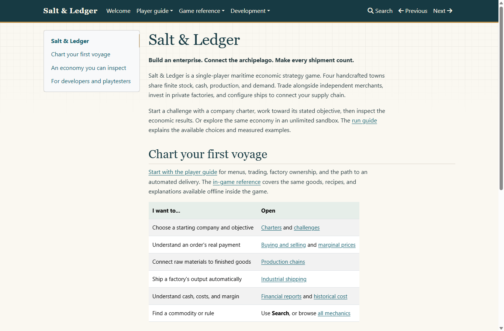
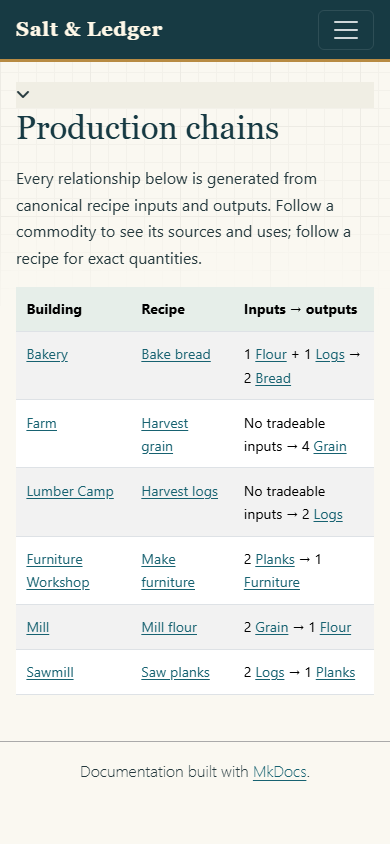

# Website, shared reference, and publishing

The documentation remains a static MkDocs site with local search. The Player guide is separate from generated Game reference and Development documentation. No server application, external account, or online service is required to use it locally.

## Build and inspect locally

Run from the repository root:

```text
python -m pip install -r requirements.txt
python tools/validate_data.py
python tools/generate_docs.py --check
python -m unittest discover -s tests/python -v
python -m mkdocs build --strict
python -m mkdocs serve --dev-addr 127.0.0.1:8000
```

Open `http://127.0.0.1:8000/`. Check the welcome page, Player guide navigation, search, [production chains](reference/chains.md), a commodity → recipe → building link sequence, and the shared [player mechanics](reference/catalog-mechanics.md). Narrow the viewport to a phone width as well as checking desktop readability. Tables scroll horizontally within the page rather than forcing the whole page wider.

For the exact built artifact, serve `site/` with `python -m http.server 8000 --bind 127.0.0.1 --directory site`. Search fetches a local JSON index, so use HTTP instead of opening HTML directly with `file://`. `site/` is generated and ignored.

### Task 1.7 local review

The built site was rendered in installed Chrome 155 at **1366×900** and **390×844**. The welcome page, player guide, run/charter guide, production chains, Bread reference, and historical-cost help were checked at both sizes. Screenshots showed readable text and tables; DOM checks found no horizontal page overflow or broken images. The review followed Bread → Bake bread → Bakery, opened the mobile Player guide menu and Getting started, and confirmed that local search found the shared historical-cost explanation.

The connected browser inventory was unavailable. An isolated headless Chrome profile served the local site instead; its first sandboxed renderer launch failed, and a permitted process launch succeeded. This was a local static-site review, separate from Unity Editor/player verification.





## One reference, two presentations

`data/content.json` remains the only authored source of canonical commodity, building, and recipe facts. `data/player-help.json` contains the compact player explanations for non-data-derived behavior. Its schema and semantic validator reject unknown properties, invalid or duplicate IDs, blank text, and broken links to canonical or other help entries.

`tools/generate_docs.py` emits:

| Artifact | Purpose |
| --- | --- |
| `docs/reference/goods/`, `buildings/`, `recipes/` | Canonical facts and forward/reverse cross-links |
| `docs/reference/chains.md` | Generated recipe input/output relationships |
| `docs/reference/mechanics/` | Shared player-help paragraphs and related links |
| `generated/encyclopedia.json` | Offline reference payload used by Unity |

Encyclopedia format version **2** contains `goods`, `buildings`, `recipes`, and `mechanics` arrays. Every entry has `id`, `name`, `description`, `paragraphs`, `relatedIds`, and `wikiPath`. Canonical entries also retain typed recipe relationships, ingredients, quantities, and effective recipe kind. `sourceSchemaVersion` and `sourceHelpSchemaVersion` are **1**. Stable ID sorting keeps output independent of source collection order; authored paragraph order remains intentional.

Generated canonical paragraphs and chain summaries derive from recipe data. Scenario prices, construction costs, intervals, charter assets, deadlines, and scoring thresholds are not copied into canonical definitions. Update shared help when implemented behavior changes; keep developer-level contracts and experiment evidence in their authored documents.

After editing either source, run `python tools/generate_docs.py`, review the generated changes, and commit them with the source. Do not edit generated reference pages or the encyclopedia by hand. `--check` is read-only and reports changed, missing, or unexpected files.

## Stage the offline game reference

`python tools/prepare_unity.py` validates current content and help, checks that the committed encyclopedia exactly matches generation, rebuilds the portable simulation, and stages:

```text
unity/Assets/Generated/Simulation/SaltAndLedger.Simulation.dll
unity/Assets/Generated/Resources/CanonicalContent.json
unity/Assets/Generated/Resources/Encyclopedia.json
```

The format-version-2 staging manifest fingerprints simulation sources, canonical data/schema, help/schema, generator and preparation policy, and the generated encyclopedia. Preparation rejects missing or stale reference data before building. `python tools/prepare_unity.py --check` verifies sources and staged bytes without the SDK or rebuilding. Stable metadata preserves Unity asset identities.

Unity consumes `Resources/Encyclopedia` as a bundled text asset. It does not fetch website content, use an online explanation service, or copy another JSON assembly. See [Unity verification](UNITY.md) for runtime import and player evidence.

## Optional GitHub Pages publication

The repository includes a **manual-only** `Publish documentation` workflow in `.github/workflows/pages.yml`. It validates and builds `site/`, uploads that artifact, then deploys through the `github-pages` environment. Ordinary pushes and pull requests do not publish.

Publication has **not been performed as part of this task**. No repository Pages setting or environment protection has been changed. The workflow is preparation, not evidence of a live website.

When the repository owner decides to publish:

1. Merge the reviewed workflow and site changes to `main`.
2. In the GitHub repository, open **Settings → Pages → Build and deployment → Source**, and select **GitHub Actions**.
3. Review the `github-pages` environment's allowed deployment branches and any required reviewers.
4. Open **Actions → Publish documentation → Run workflow**, choose `main`, and run it.
5. Inspect both jobs. Use the URL reported by the successful deployment; only then describe the site as published.

GitHub's documented workflow requires a Pages artifact and a deployment job with `pages: write` and `id-token: write`; the committed workflow grants those permissions only to that job. The build uses the configured Pages base URL, so project-subdirectory links and search remain correct. See [GitHub's custom Pages workflow documentation](https://docs.github.com/en/pages/getting-started-with-github-pages/using-custom-workflows-with-github-pages).

If Pages is unavailable for the repository's account/visibility or has not been enabled, deployment cannot complete. The local build and ordinary validation workflow still work. Do not enable automatic publication or change repository visibility as a workaround.
